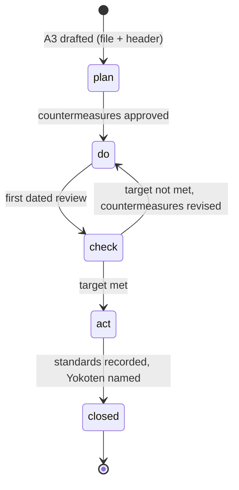

# A3 Spine - Plan

## Goal Capsule

- **Objective:** Any later session, project, or new team member (human or AI) can find every A3 (a Toyota-style one-page problem-solving record), see where it stands in its Plan-Do-Check-Act (PDCA) cycle, and trace each countermeasure to the issues, decisions, and standards it produced, without anyone remembering where the A3 was saved. Dated follow-up reviews happen on time.
- **Means:** A3s of record live as markdown files in Git, with a front-matter header and a stable ID for each component. This plugin owns the A3 practice, split into separate capabilities: coaching, end-to-end facilitation, reference content, and a review command with reviewer subagents.
- **Product authority:** The plugin maintainer (decision cards, 2026-10-28). This plan builds on [the A3 conductor ideation](../ideation/2026-10-21-a3-conductor-command-ideation.md): its idea 8 (codify the hand-run procedure first), idea 2 (authorship guard), idea 3 (the A3 is a file with history), and idea 6 (no DONE, a dated check) are inherited here, not re-decided.
- **Open blockers:** None.

---

## Product Contract

### Summary

Give each A3 one home in Git from the moment it is drafted. Give its header and its components stable IDs. Let the A3's stage, its review dates, and its outcomes connect to the organization's work tracker and scheduler when an integration for them is installed. Split the single `a3` skill into a coaching skill, a facilitation skill that runs the whole cycle, reference content, and a review command.

### Problem Frame

A3s made in AI-assisted sessions get saved wherever the session happened to be: a chat project folder, a rendered page, a drive. Later sessions find them only if someone remembers the path. Dated follow-up reviews are written into the A3, but nothing reminds anyone of them. Countermeasures become issues, decision records, and pull requests, but nothing points back from those items to the A3 and the countermeasure that caused them.

The `a3` skill teaches the method and says an A3 "is a thinking tool and a coaching conversation, not a report to be filed". That stays true. But the skill has no guidance on where an A3 lives, how its parts are named, or how it is followed up, so the coaching conversation leaves no findable record.

### Key Decisions

- **A3s of record live in Git as markdown with a front-matter header and a stable ID per component; a component database comes later.** (session-settled: user-directed — chosen over a component database now, files in shared drives, and deciding later: Git gives review of each PDCA revision, diff history, CI checks, and IDs that prepare for a database.) Governs R1, R2, R3, R4. Recorded in [ADR-0003](../adr/0003-an-a3-of-record-lives-in-git-as-markdown-with-an-id-for-each-component.md).
- **Each A3 lives in the repository of its topic, at the same path in every repository.** (session-settled: user-directed — chosen over one central A3 folder and a dedicated memory repository: each A3 sits with the work, decisions, and issues it concerns.) The cost is that finding A3s across topics needs a cross-repository index. Governs R1, R10, R11.
- **This plugin owns the whole A3 practice, split into separate capabilities.** (session-settled: user-directed — one home for the A3 practice, with coaching, facilitation, reference, and review kept distinct, as compound-engineering separates `lfg` from its review agents.) Governs R12 to R15.
- **Organization-specific steps stay outside the method.** `a3-facilitation` calls installed integration skills for the work tracker and the scheduler, and skips those steps when none is installed. (session-settled: user-directed.) Organization-specific wiring goes in a private overlay plugin, never in this plugin. Governs R16.
- **The authorship rule depends on the seat (inherited from the 2026-10-21 ideation, idea 2).** When a human holds the A3, Claude never writes section content. When Claude holds the A3 (an agent explaining its own work), Claude drafts and a human or named reviewer coaches. The header's Holder field tells `a3-facilitation` which rule applies. Governs R2, R13.
- **The tracker item is the home of the work; the A3 file is the home of the reasoning.** Each links to the other. When a tracker also holds the stage, a check keeps the two equal. Governs R2, R6, R8.

### Actors

- A1. The A3 owner (the person or agent whose problem it is) and the coach.
- A2. A Claude session: facilitates, files changes, and records review outcomes. It drafts content only when it holds the A3.
- A3. This plugin's A3 capabilities: `a3-coaching`, `a3-facilitation`, the A3 reference, and `review-a3` with its reviewer subagents.
- A4. An optional work tracker, reached through an installed integration skill.
- A5. An optional scheduler, reached through an installed integration skill.
- A6. A future team member (human or AI): finds and reuses A3s with no chat history.

### Requirements

**Home and format**

- R1. An A3 of record is one markdown file in the repository of its topic, at the same folder path in every repository, created when the A3 is first drafted, not copied there later.
- R2. Each A3 file opens with a header that names: the A3 ID, title, owner, holder, coach, PDCA stage, date opened, next review date, a link to the tracker item when one exists, and related decision records and issues.
- R3. Each component in an A3 has a stable ID with a fixed prefix: BG (background), CC (current condition), G (goal and target measure), RC (root cause), CM (countermeasure), CK (check), and YK (Yokoten, spreading a learning to other areas). An ID is never reused after removal.
- R4. Each PDCA revision of an A3 lands as a reviewed change, so the history shows how each component changed over time. The revision log names what changed and who asked (2026-10-21 ideation, idea 3).

**Lifecycle and cadence**

- R5. The header stage is one of `plan`, `do`, `check`, `act`, or `closed`, and moves only on a reviewed change to the file.
- R6. When a work-tracker integration is installed, the tracker item carries the same stage.
- R7. Each dated review in an A3's plan is written into the header. When a scheduler integration is installed, it also becomes a scheduled task. The run ends at "check scheduled", never at DONE (2026-10-21 ideation, idea 6).
- R8. A check reports every A3 whose next review date has passed with no revision since that date, and, when a tracker holds the stage, every A3 whose header stage differs from it.

**Linkage and provenance**

- R9. Each issue, decision record, pull request, or solutions entry created from a countermeasure carries the line `Origin: A3 <A3 ID> <CM ID>`. When an A3 reaches Act, each change adopted as a standard is recorded with an Origin line, and each YK item names the other areas where the learning applies.

**Discovery**

- R10. One index lists every A3 in the organization's repositories with its ID, repository, title, owner, stage, and next review date. It is generated from the headers, not written by hand.
- R11. A session with no memory finds the A3s that concern a topic from the index or by one search across the organization's repositories.

**A3 capabilities in this plugin**

- R12. An `a3-coaching` skill guides a coach in helping someone create an A3, keeping today's coaching method and questions.
- R13. An `a3-facilitation` skill runs and tracks the end-to-end A3 cycle, from first draft through reviews to close, the way `lfg` runs a code change, but paced and resumable at each Reflection Pause (2026-10-21 ideation, idea 1). It starts as the codified hand-run procedure (idea 8), creates the file and header (R1, R2), and moves the stage (R5).
- R14. One A3 reference holds the parts of an A3, the header, the component IDs (R3), and the quality concerns. The other A3 capabilities cite it instead of repeating it.
- R15. A `review-a3` command runs reviewer subagents over an A3 and returns their findings, sorted into Applied (proven errors) and Proposed (goal or plan changes put to the owner). The first set is a strategic-management reviewer, a gemba reviewer, a formatting reviewer, and a lean-sensei reviewer.
- R16. Steps that need a work tracker or a scheduler (R6, R7) run through installed integration skills. When none is installed, `a3-facilitation` skips the steps and says which ones it skipped.

### Lifecycle

### Key Flows

- F1. Birth of an A3
  - **Trigger:** An owner or a session starts an A3 with `a3-facilitation`.
  - **Steps:** `a3-facilitation` runs the coaching conversation through `a3-coaching`. When a first draft exists, it creates the file with a header and component IDs and sets the stage to `plan`. With a tracker integration installed, it creates or links the tracker item with a draft-and-confirm step.
  - **Covered by:** R1, R2, R3, R5, R6, R12, R13, R16
- F2. Dated review
  - **Trigger:** A review date in the A3's plan arrives.
  - **Steps:** The check (R8) or the scheduled task surfaces the review. The session checks the CK items against the targets, asks the owner when a choice is needed, records the decision, revises the A3, runs `review-a3` on the revision, and lands it as a reviewed change, moving the stage when the result requires it.
  - **Covered by:** R4, R5, R7, R8, R13, R15
- F3. Act and close
  - **Trigger:** A check shows the target is met.
  - **Steps:** Each adopted change becomes a decision record or a solutions entry with an Origin line. YK items name other areas. The stage moves to `act`, then to `closed` when the standards are recorded.
  - **Covered by:** R5, R9

### Acceptance Examples

- AE1. **Covers R8.** Given an A3 with next review 2026-11-11, when no revision of that A3 lands by the end of 2026-11-11, then the check lists it as overdue on 2026-11-12.
- AE2. **Covers R6, R8.** Given an A3 header says `check` and its tracker item still says `do`, when the check runs, then it reports the mismatch and names both values.
- AE3. **Covers R9.** Given a decision record is drafted to carry out CM-3 of an A3, when it is written, then it includes `Origin: A3 <A3 ID> CM-3`.
- AE4. **Covers R3.** Given RC-2 is removed from an A3, when a new root cause is added, then it gets the next unused number, not RC-2.
- AE5. **Covers R15.** Given an A3 revision whose CC items have no IDs, when `review-a3` runs, then the formatting reviewer reports each CC item that lacks an ID.
- AE6. **Covers R16.** Given no tracker integration is installed, when `a3-facilitation` creates an A3, then it writes the file and header and reports that the tracker steps were skipped.
- AE7. **Covers R2, R13.** Given the header names a human as Holder, when the owner says "just write it", then `a3-facilitation` answers with the next coaching question and writes no section content.

### Success Criteria

- A session with no memory lists every open A3 and its stage with one search or one index read.
- No dated review stays unnoticed for more than one day after its date.
- Every decision record or issue created from a countermeasure after the spine ships traces back to its A3 and CM ID.

### Scope Boundaries

**Deferred for later**

- A component database that stores components and renders A3s as views. The stable IDs in R3 prepare for it.
- A published site for A3s; the generated index in R10 comes first.

**Outside this work**

- Changing how the A3 method coaches.
- Organization-specific tracker, scheduler, and session-closure wiring. That belongs in a private overlay plugin or in the organization's own configuration repository.

### Dependencies / Assumptions

- The 2026-10-21 A3 conductor ideation stays the source for the conductor's pacing, gates, and authorship guard.
- Integration skills for a tracker and a scheduler exist or can be written in an overlay; this plugin only calls them.
- A session can write only to repositories in its scope, so filing an A3 in a new topic repository may first need that repository added to the session.

### Outstanding Questions

**Deferred to Planning**

- The exact header field names, the A3 ID format, and the common folder path (for example `docs/a3/`).
- How the cross-repository index (R10) gathers A3s, where it is published, and how often it refreshes.
- Where an A3 goes when its topic has no repository yet.
- The full reviewer set for `review-a3` beyond the first four, and whether `a3-facilitation` or `a3-writing` is the better name.
- What happens to the current `a3` skill: renamed to `a3-coaching`, or kept as a short router to the new capabilities.
- Where the R8 check runs (CI on each change, a scheduled job, or both).
- The contract between `a3-facilitation` and an integration skill (what it passes and what it expects back).

### Sources / Research

- [The A3 conductor ideation (2026-10-21)](../ideation/2026-10-21-a3-conductor-command-ideation.md).
- `skills/a3/SKILL.md` and `skills/lean-problem-solving/SKILL.md` (phase exit criteria and Reflection Pauses).
- Prior art found on 2026-10-28: icco/postmortems (validated markdown that builds an index), GitLab's incident follow-up tracker, and adr-tools and log4brains (supersession and indexes for decision records). Almost no public practice keeps A3s in Git, so this is a new pattern.
