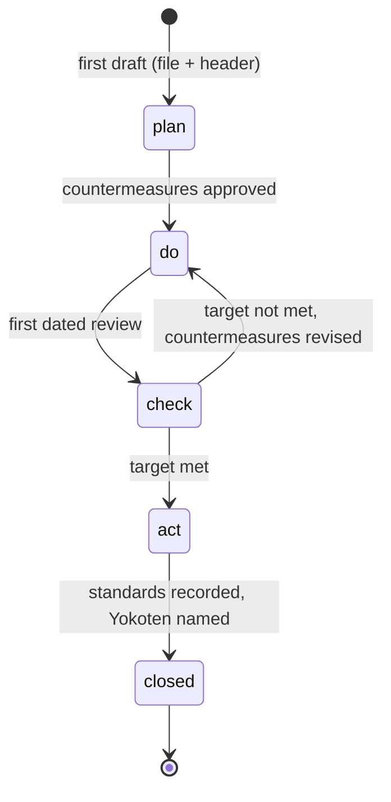

# A3 reference

This reference defines the A3 file of record, format `a3/v1`. [ADR-0003](../../docs/adr/0003-an-a3-of-record-lives-in-git-as-markdown-with-an-id-for-each-component.md) records the decision and its amendment. For the A3 method and the coaching conversation, use the `a3` skill. This reference is about the file.

An A3 is still a thinking tool and a coaching conversation. The file keeps the thinking findable after the conversation ends.

## 1. Where an A3 lives

- One A3 is one markdown file in Git.
- Put the file in the repository of its topic, in the folder `docs/a3/`. Use the same folder in every repository.
- Create the file when the first draft exists. Do not copy it into Git later.
- The file name is the A3 ID plus `.md`, for example `docs/a3/A3-2026-01-15-late-invoices.md`.
- Each PDCA revision lands as a reviewed change (a pull request).

## 2. The A3 ID

- Format: `A3-YYYY-MM-DD-short-slug`. The date is the day the A3 opened. The slug is 2 to 5 lowercase words with hyphens.
- Set the ID once, at birth. Do not change it when the title changes.
- The ID needs no counter and no registry, so two sessions on different branches or in different repositories do not get the same ID.
- From another repository, cite the A3 as `<owner>/<repo>:A3-...` when the repository is not clear.

## 3. The header

The file opens with YAML front matter. Use only scalars, inline lists `[a, b]`, and block lists (`- item`).

| Field | Required | Value |
|-------|----------|-------|
| `format` | yes | `a3/v1` |
| `a3_id` | yes | The A3 ID. It equals the file name and its date equals `opened`. |
| `title` | yes | The problem, not a solution in disguise. |
| `owner` | yes | Whose problem it is: a person, a role, or an agent. |
| `holder` | yes | Who writes the sections. |
| `holder_type` | yes | `human` or `agent`. It decides the authorship rule (section 7). |
| `coach` | yes | Who reviews and asks the questions. |
| `stage` | yes | `plan`, `do`, `check`, `act`, or `closed` (section 5). |
| `opened` | yes | `YYYY-MM-DD`. |
| `next_review` | until closed | `YYYY-MM-DD` of the next dated review. `null` only when the stage is `closed`. |
| `revision` | yes | `A`, `B`, `C`, ... One letter for each reviewed revision. |
| `tracker` | no | `null`, or the https URL of the work-tracker item. |
| `related` | no | List of related decision records, issues, and pull requests. |
| `retired_ids` | no | List of component IDs that were removed. They are never used again. |

Other keys fail the check. An organization overlay can add keys with an `x-` prefix, for example `x-project-id`.

Use role words or names that the repository already makes public. Put no private client data in an A3 in a public repository.

## 4. Sections and component IDs

The body has these `##` sections, in this order. Each section defines components with one prefix.

| Section | Prefix | Holds |
|---------|--------|-------|
| `## Background` | BG | Why the problem matters now. |
| `## Current condition` | CC | Facts and data from gemba. No causes. |
| `## Goal` | G | The target measure, its date, and a guardrail measure. |
| `## Root cause analysis` | RC | Causes, with the analysis that shows them. |
| `## Countermeasures` | CM | Each countermeasure, the RC it addresses, and its ADP type. List rejected options. |
| `## Plan` | none | Who does what, by when. Cite the CM IDs. |
| `## Check` | CK | Each dated check, its target, and a switch trigger. |
| `## Yokoten` | YK | Other areas where the learning applies, and who raised it. |
| `## Revision log` | none | One line per revision: letter, date, what changed, who asked. |

Rules for component IDs:

- Write an ID as the prefix, a hyphen, and a number: `RC-1`, `CM-3`.
- Define a component in one of two ways: a list item that opens with the bold ID (`- **CC-1** ...`), or a table row whose first cell is the ID (`| CM-1 | ... |`).
- Define each ID once, in the section of its prefix.
- When you remove a component, add its ID to `retired_ids`. A new component gets the next unused number. For example, after `RC-2` is removed, the next root cause is `RC-3`, not `RC-2`.
- Any other mention of an ID is a reference. A reference must point to a defined or retired ID.

A section can be empty early in the cycle. Write "Not yet." under it. Do not remove the heading.

## 5. Stages



- The stage moves only in a reviewed change to the file.
- Each dated review in the plan goes into `next_review`. A run ends at "check scheduled", never at "done".
- When a work tracker holds the stage too, the tracker item and the header show the same stage.

## 6. Links: the Origin line

- Each issue, decision record, pull request, or solutions entry made from a countermeasure carries one line: `Origin: A3 <A3 ID> <CM ID>`. Example: `Origin: A3 A3-2026-01-15-late-invoices CM-1`.
- In the stage `act`, record each adopted standard with an Origin line.
- The tracker item is the home of the work. The A3 file is the home of the reasoning. Each links to the other.

## 7. Authorship depends on the holder

- `holder_type: human`: Claude never writes section content. Claude asks the next coaching question, files the changes the holder dictates, and runs the checks.
- `holder_type: agent`: the agent drafts from its own work. A human or a named reviewer coaches, and the review cannot be skipped.

## 8. Quality concerns

A reviewer checks these. The first four come from the `a3` skill's common mistakes.

- **Solution first.** Countermeasures came before measurement. Say so, and add the data step before the build step.
- **No data in the current condition.** Each CC item needs a number or an observation with its source.
- **Root cause is human error.** Ask what in the system allowed the error.
- **Countermeasure without a root cause.** Each CM names the RC it addresses.
- **Untagged claims.** Tag each claim as fact (with its source), inference, or not measured (with the follow-up that would measure it).
- **No guardrail or switch trigger.** The goal names a guardrail measure. Each check names what result changes the plan.
- **Missing IDs.** Each component has an ID. No ID is reused.
- **Stale review.** `next_review` is in the past and no revision landed after it.

## 9. The check

`scripts/check-a3.mjs` in this plugin checks the header, the file name, the sections, and the component IDs.

```bash
node "${CLAUDE_PLUGIN_ROOT}/scripts/check-a3.mjs" docs/a3/*.md
```

With no arguments, in this repository, it checks `docs/a3/` and the example. CI runs it on each pull request.

## 10. Example

[`examples/A3-2026-01-15-late-invoices.md`](examples/A3-2026-01-15-late-invoices.md) is a complete A3 in this format. The organization, people, and numbers are made up.
